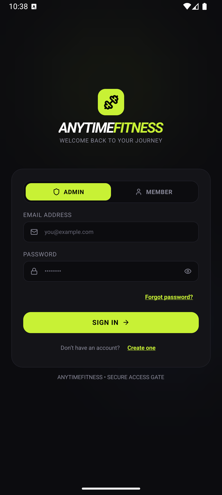
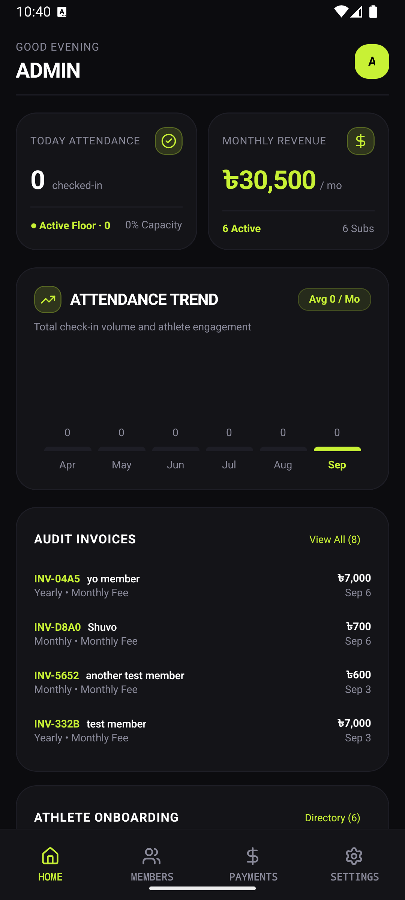
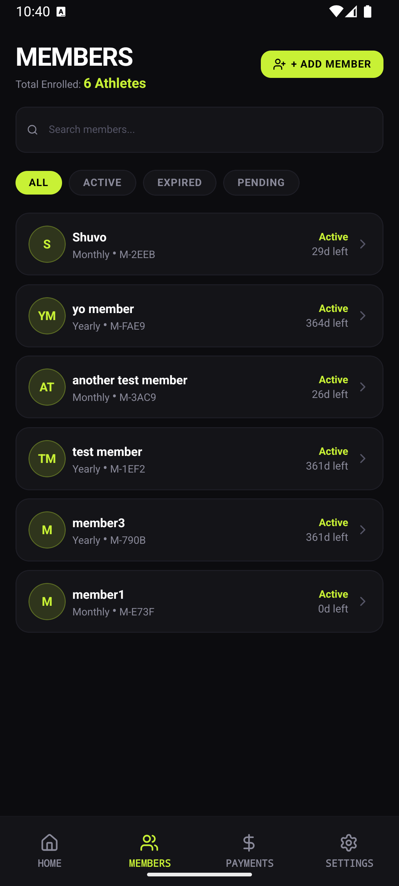
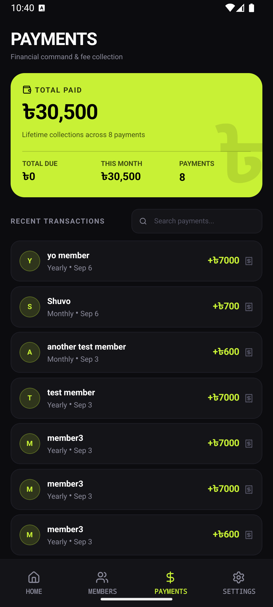
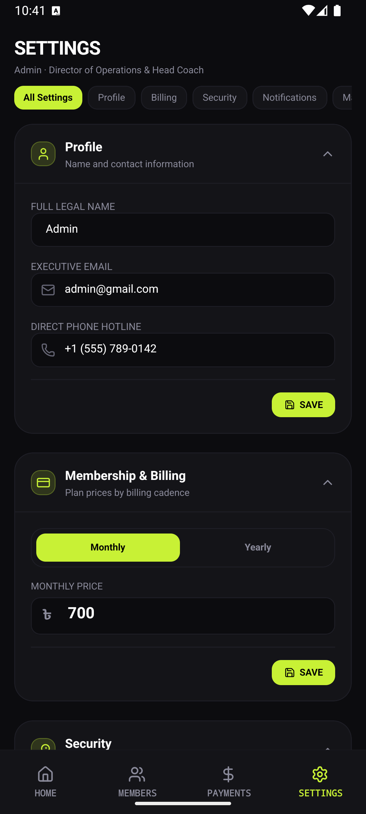

# AnytimeFitenss

A dual-persona gym management platform built with Expo — an **admin/staff console** for running the facility and a **member app** for members. Both personas share one codebase powered by Supabase (Postgres, Auth, Realtime, Storage).

> Package/repo name: `anytimefitenss` · Product brand: **AnytimeFitenss**

---

## Screenshots

| | | |
|---|---|---|
|  |  |  |
|  |  | |

---

## Features

### Admin console
- **Live dashboard** — real-time gym occupancy vs. capacity, today's check-ins, monthly check-in trend chart, monthly revenue, recent members & transactions.
- **Members management** — member list with search and status filters, member detail with plan assignment, and a full onboarding form (formSheet).
- **Payments** — collect dues, generate invoices, view revenue trends and transaction history.
- **Settings** — profile, facility, billing/currency, security (PIN, 2FA), notifications, and maintenance, backed by `react-hook-form` + `zod` validation.

### Member app
- **Login** for members (email/password or phone + PIN) and staff are segmented on the auth screen.
- **Registration** with role-based routing, and **forgot password** flow (magic link).
- Member dashboard currently stubbed ("Coming soon") — the member workout/diet/payments stack is on the roadmap.

### Security & architecture
- Session persistence via `expo-secure-store`, role-based route guards in Expo Router, and **Postgres Row-Level Security** as the real enforcement boundary.
- TanStack Query v5 for all server + client state, with live attendance via Supabase Realtime.

---

## Tech stack

| Layer | Technology |
|---|---|
| Runtime | Expo SDK 57 · React Native 0.86 · React 19.2 · TypeScript (strict) |
| Navigation | Expo Router (file-based, `src/app/`) |
| Backend | Supabase — Postgres, Auth (JWT), Realtime (WSS), Storage, Edge Functions |
| Schema | Drizzle ORM (`src/db/schema.ts`) → SQL migrations |
| State / data | TanStack React Query v5 |
| Styling | NativeWind v5 + Tailwind CSS v4 + gluestack-ui v5 |
| Forms | react-hook-form + zod |
| Icons | lucide-react-native |
| Charts | Victory Native / react-native-svg |

---

## Getting started

1. Install dependencies:

   ```bash
   npm install
   ```

2. Add your Supabase credentials to a local `.env` (never commit `.env*` files):

   ```
   EXPO_PUBLIC_SUPABASE_URL=https://<project>.supabase.co
   EXPO_PUBLIC_SUPABASE_ANON_KEY=<anon-key>
   SUPABASE_DB_URL=postgresql://...   # CLI-only, never prefixed EXPO_PUBLIC_
   ```

3. Start the app:

   ```bash
   npx expo start
   # or
   npm run ios       # iOS simulator
   npm run android   # Android emulator
   npm run web       # Web
   ```

Only variables prefixed `EXPO_PUBLIC_` reach client code. `SUPABASE_DB_URL` is server/CLI-only — never ship it in the app bundle.

### Database workflow

```bash
npx drizzle-kit generate                                                # schema.ts → SQL in supabase/migrations/
npx supabase db reset                                                   # recreate local DB from migrations
npx supabase db push                                                    # apply migrations to linked project
npx supabase gen types typescript --local > src/types/database.types.ts # regenerate types
```

---

## Verification

```bash
npx tsc --noEmit   # typecheck (strict) — must pass
npm run lint       # ESLint
```

---

## Project structure

```
src/
├── app/                       # Expo Router routes
│   ├── (auth)/                # login, register, forgot-password
│   ├── (admin)/               # home, members/, payments/, settings
│   └── (member)/              # dashboard
├── services/                  # plain async functions calling Supabase (no React)
├── hooks/                     # React Query hooks wrapping src/services
├── components/
│   ├── ui/                    # gluestack-ui v5 components (copy-in, never hand-edit)
│   ├── common/                # app-specific shared components
│   └── charts/                # Victory Native / SVG charts
├── api/                       # zod validation schemas per form
├── db/                        # Drizzle ORM schema (source of truth)
├── lib/                       # supabase client, query client, utils
└── types/                     # generated database.types.ts, admin settings types
```